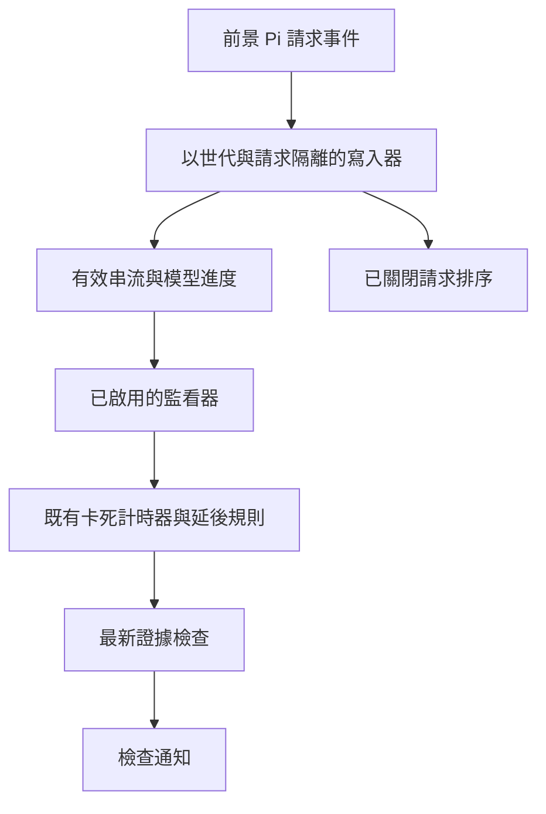
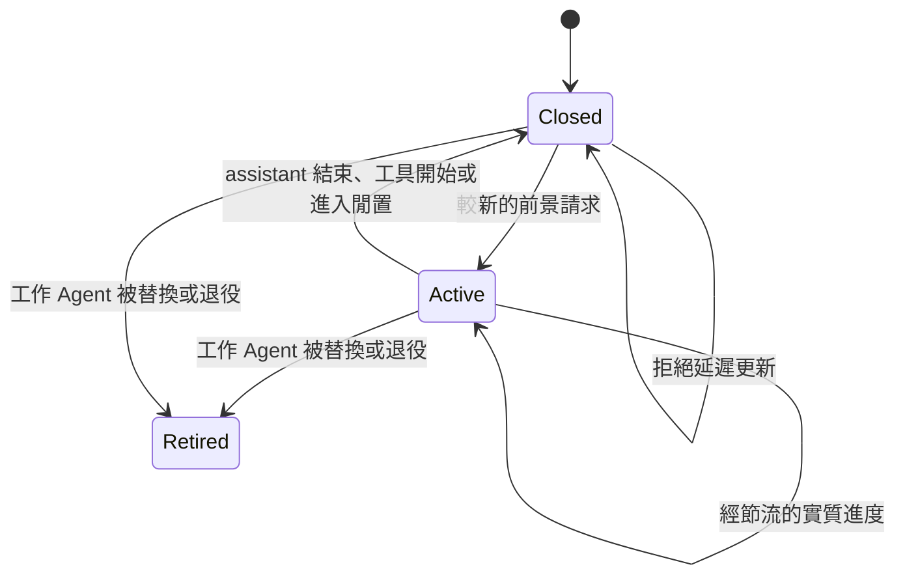

# Pi 工作 Agent 串流靜默 — 計畫

## 目標摘要

- 目標：啟用串流監控的操作者，在 Pi 工作 Agent 不再產生模型進度時，會收到可據以處理的檢查通知，同時不因正常的無輸出工具而觸發警報。
- 手段：使用前景 Pi 生命週期證據，以及既有的忙碌狀態寫入器與卡死計時器。
- 依據：產品行為由 Issue #6881 與維護者的分類判定定義；交付遵循儲存庫的貢獻與驗證規則。
- 執行：實作下列具有相依關係的單元，並保留既有預設行為。
- 停止條件：已有涵蓋此需求的 PR、必要驗證無法執行，或生命週期假設不安全，都會阻擋發布。
- 後續責任：實作階段回傳本機證據；外層 LFG 工作流程負責審查與 no-mistakes 發布。

---

## 產品契約

### 摘要

新增可選的 Pi 工作 Agent 模型串流靜默觀察，並能辨識所處階段。
檢查原因會指出模型靜默，同時保留既有的升級處理節奏與延後規則。

### 問題界定

當 Pi 請求已被接受卻停止串流時，會持續維持忙碌，直到一般的一小時上限到期。
現有證據無法區分這種請求與正常的無輸出建置，導致操作者損失工作通道時間。

### 需求

**啟用與相容性**

- R1. `FM_STREAM_SILENT_MAX_SECS` 未設定、為空、零、負值、格式錯誤或超出支援數值範圍時，功能關閉；正的十進位秒數會啟用串流觀察。
- R2. 預設關閉的工作 Agent、不受支援的 Pi 版本、缺少監測接線與其他執行環境，都會保留既有的忙碌時長上限與原生進度行為。
- R3. 啟用狀態會在產生工作 Agent 擴充套件時記錄，觀察用監看器也必須獨立啟用；變更執行中監看器的設定，無法替較舊的工作 Agent 補上監測接線。

**生命週期與擁有權**

- R4. 只有目前的工作 Agent 世代與目前的前景請求，可以建立或更新有效串流證據；寫入器會拒絕過時、已關閉、格式錯誤與尚未啟動監看的請求事件。
- R5. 有實質內容的 assistant 文字、思考或工具呼叫引數活動，最多每秒更新一次串流證據；空白、未變更的事件與背景提供者流量不算進度。
- R6. assistant 訊息完成、工具開始執行、進入閒置、替換與退役，都會清除有效證據；延遲更新不可重新建立它。
- R7. 串流觀察不會改變語意上的忙碌狀態，也不會製造已完成回合通知；其進度錨點擴充與 R1 共用啟用邊界。

**檢查**

- R8. 目前串流過期時，不論面板穩定或持續變動，都會進入既有、僅執行檢查的卡死處理節奏；原因會指出模型串流靜默與觀察到的持續時間。
- R9. 新進度、完成、請求替換或無效證據，會取消過時的串流升級處理階段；監看器在發布檢查通知前，會立即重新驗證證據。
- R10. 既有的宣告等待、工作樹寫入、失效端點、升級次數與深度檢查行為持續適用；不加入自動插斷、重新啟動或提供者復原。

### 驗收範例

- AE1. 涵蓋 R1-R3：未選擇啟用時，一般 Pi 請求不會產生串流標記，一般忙碌上限也不變。
- AE2. 涵蓋 R4-R9：目前請求在一般上限之前停止產生內容；超過設定的靜默門檻與卡死延遲後，檢查會指出停滯的模型階段。
- AE3. 涵蓋 R6、R9-R10：準備檢查期間，工具開始執行或新請求產生進度；過時串流證據不會產生模型靜默通知。
- AE4. 涵蓋 R4、R6：舊世代更新與已關閉請求的延遲更新，不會影響替代請求。

### 範圍邊界

此議題涵蓋工作 Agent 串流觀察及其既有檢查路徑。
不包含提供者重試、自動復原、主要 Agent 監督接線，以及二副（secondmate）喚醒停滯的重新設計。
其他廠商版本必須先完成獨立的真實驗證，才能加入已驗證版本集合。

---

## 規劃契約

### 關鍵技術決策

- KTD1. 在 `bin/fm-busy-event.sh` 既有的世代鎖之下擴充，並在 `bin/fm-busy-lib.sh` 說明紀錄契約（R4、R6-R7）。
  將已關閉請求的排序紀錄與有效證據分開保存，避免延遲事件讓它復活。
- KTD2. 使用 Pi 每次前景呼叫的 `context` 事件開啟追蹤（R4-R6）。
  Pi 1.2.0 的提供者回呼與背景快取預熱共用，因此單靠 `before_provider_request` 無法辨識前景請求。
  觀察區間包含前景請求準備與驗證，檢查原因與文件必須清楚說明。
- KTD3. 將產生出的擴充套件寫入序列化，並讓遞增的請求身分一路傳到寫入器（R4-R6）。
  比較實質內容的快照，而非可變物件的身分；關閉處理器會在等待磁碟寫入前重設本機活動。
- KTD4. 對選定的可執行檔，以明確的版本集合進行驗證，初期只包含 Pi 1.2.0（R2-R3）。
  未驗證版本保留舊有接線，並在選擇啟用時輸出可據以處理的診斷，而不宣稱具備串流保護。
- KTD5. 沿用既有卡死計時器與延後規則，新增串流證據身分，並在通知時重新檢查（R8-R10）。
  計時器屬於單一世代／請求／活動階段；身分變更時就重設。
- KTD6. 將正常模型進度與舊有原生進度標記分開（R1-R2、R7）。
  監看器可納入已選擇啟用的模型進度錨點，同時避免之後停用功能的監看器繼承遭變更的預設錨點。

### 高層次技術設計

### 假設與風險

此選項控制觀察功能，不控制模型逾時或復原。
在 shell 算術運算前，先對正的十進位輸入做有界驗證。
標記寫入失敗會降低觀察能力，但不可破壞 Pi 本身的生命週期；重複失敗必須回報，不可悄悄當作已提供保護。
重新驗證只能證實發布決策當下的目前觀察狀態，絕不授予復原工作 Agent 的權限。
不需要私人主目錄或憑證：真正安裝的 Pi 可在隔離 Agent 目錄中，透過公開 SDK 使用本機合成串流。

---

## 實作單元

### U1. 負責前景串流生命週期

**目標：** 從已驗證且已選擇啟用的 Pi 工作 Agent，產生有序且綁定世代的串流證據。
**需求：** R1-R7、AE1、AE4。
**相依關係：** 無。
**檔案：** `bin/fm-busy-lib.sh`、`bin/fm-busy-event.sh`、`bin/fm-spawn.sh`、`tests/fm-busy-state.test.sh`、`tests/fm-busy-adapter-wiring.test.sh`。
**方法：** 依 KTD1-KTD4 與 KTD6，擴充既有異動與產生擴充套件的邊界。
**執行註記：** 先透過可執行的寫入器與產生擴充套件介面，重現缺少串流行為的問題。
**既有模式：** 既有 `progress`、`arm`、`retire`、產生出的 Pi 生命週期處理器與 `drive_pi_ext`。
**測試情境：**

- 開啟目前請求、更新實質進度，再將其關閉，且不改變語意上的忙碌狀態或回合通知。
- 拒絕尚未啟動監看與過期世代的操作、已被取代的請求事件、重複開啟，以及已關閉請求的延遲更新。
- 在 arm／retire 時清除有效狀態與排序狀態，並拒絕舊退役操作作用於新世代。
- 以未啟用、格式錯誤、已啟用及不受支援版本等情況，驅動產生出的擴充套件。
- 測試空白／未變更／文字／思考／工具引數更新、節流、assistant 與 user／tool 訊息結束的差異、重試重新開啟，以及關閉／開始的順序。

**驗證：** 聚焦的行為測試套件通過，保留修正前失敗的證據，且不以原始碼文字斷言代替行為。

### U2. 整合靜默檢查

**目標：** 透過既有安全檢查行為，呈現過期串流證據。
**需求：** R8-R10、AE2-AE3。
**相依關係：** U1。
**檔案：** `bin/fm-watch.sh`、`bin/fm-busy-lib.sh`、`tests/fm-watch-triage.test.sh`。
**方法：** 將 KTD5 套用到兩個忙碌面板分支，將 KTD6 套用到已啟用時的時間基準選擇。
**既有模式：** `busy_turn_bound_check`、`wedge_timer_check`，以及既有的穩定／持續更新忙碌測試。
**執行註記：** 展示已接受但靜默的請求，在變更前仍無法被發現。
**測試情境：**

- 不論面板輸出穩定或變動，過期的目前串流都會在一般上限之前啟動卡死計時器。
- 低於門檻的串流、停用選項、其他執行環境、缺少／無效／已關閉／過期的標記，或長時間無輸出的工具，都不會啟動串流計時器。
- 新進度、新請求、進入閒置或替換，會清除舊階段並抑制過期的發布決策。
- 將已接受階段的時間往前調，驗證明確的模型靜默原因、一般延後規則、升級次數與依需求檢查行為。
- 在已啟用的進度之後停用觀察，確認原生／預設時間基準選擇不變。

**驗證：** 真實監看器在合成的隔離主目錄上通過行為測試，不需要實際艦隊或正式環境狀態。

### U3. 證實真實 Pi 行為並記錄啟用方式

**目標：** 端到端驗證廠商事件，並記錄支援選項與限制。
**需求：** R1-R10。
**相依關係：** U1、U2。
**檔案：** `tests/fm-pi-worker-stream-live-e2e.test.sh`、`tests/fm-pi-worker-stream-live.mjs`、`bin/fm-test-run.sh`、`docs/configuration.md`、`docs/verification/runtime-backends.md`、`.agents/skills/harness-adapters/references/harness/pi.md`。
**方法：** 依既有的保留串流 SDK 防護測試，使用真正安裝的 Pi 資源載入器／工作階段／模型執行階段，搭配隔離目錄與合成提供者傳輸層。
**測試情境：**

- 在 Pi 1.2.0 載入實際產生的工作 Agent 擴充套件，並保留已接受的模型回應；在真正的寫入器觀察開啟與實質更新。
- 釋放 assistant 完成事件、執行隔離且無害的工具，再執行後續請求；觀察清除與新的身分。
- 證明背景提供者流量無法開啟前景證據。
- 以相同的真實執行環境證明預設關閉行為，並如實回報簽章包裝程式或版本不可用造成的未涵蓋項目。

**驗證：** 真實環境防護測試會檢查真正的執行環境、拒絕空的涵蓋範圍、明列版本，並在界限內關閉自己擁有的所有資源。
持續維護的文件遵循適用對象清單，包含目前保證；任務專屬證據則保留在持續維護的本文之外。

---

## 驗證契約

透過 `bash bin/fm-test-run.sh tests/fm-busy-state.test.sh tests/fm-busy-adapter-wiring.test.sh tests/fm-watch-triage.test.sh` 執行聚焦測試套件。
透過 `bash bin/fm-test-run.sh tests/fm-pi-worker-stream-live-e2e.test.sh` 執行新的真實 Pi 防護測試，並保留精確版本與輸出。
所有變更完成後，執行 `bash bin/fm-lint.sh` 與 `bash bin/fm-doc-audience-check.sh`。
註冊新防護測試時，執行測試清單涵蓋率檢查。
必要工具不可用會阻擋發布；本範圍內不安裝工具。
本計畫沒有 UI 變更，因此瀏覽器適用性由外層工作流程檢查。

---

## 完成定義

每個單元都滿足其行為情境，並回報實際的失敗／通過證據，或明確說明未執行項目。
完整 diff 保留 R1-R10，不含放棄的實作或不相關修改。
在 no-mistakes 發布之前，獨立程式碼審查與必要本機檢查皆須通過。
PR 依接受的最終範圍引用 #6881，並保留目前 HEAD 的 no-mistakes 審查／測試／文件證明。
上層會收到標準分支、完整 HEAD、PR URL、單次 CI／審查狀態，以及所有剩餘阻礙。

### 來源

- [Issue #6881 與維護者分類判定](https://github.com/kunchenguid/firstmate/issues/6881)。
- `bin/fm-busy-event.sh`、`bin/fm-busy-lib.sh`、`bin/fm-spawn.sh`、`bin/fm-watch.sh`。
- `tests/fm-pi-branch-live-e2e.test.sh` 的保留串流 SDK 整合模式。
- 已安裝的公開 Pi 1.2.0 擴充宣告、SDK 提供者回呼接線、快取預熱器與 Agent 迴圈生命週期實作。
